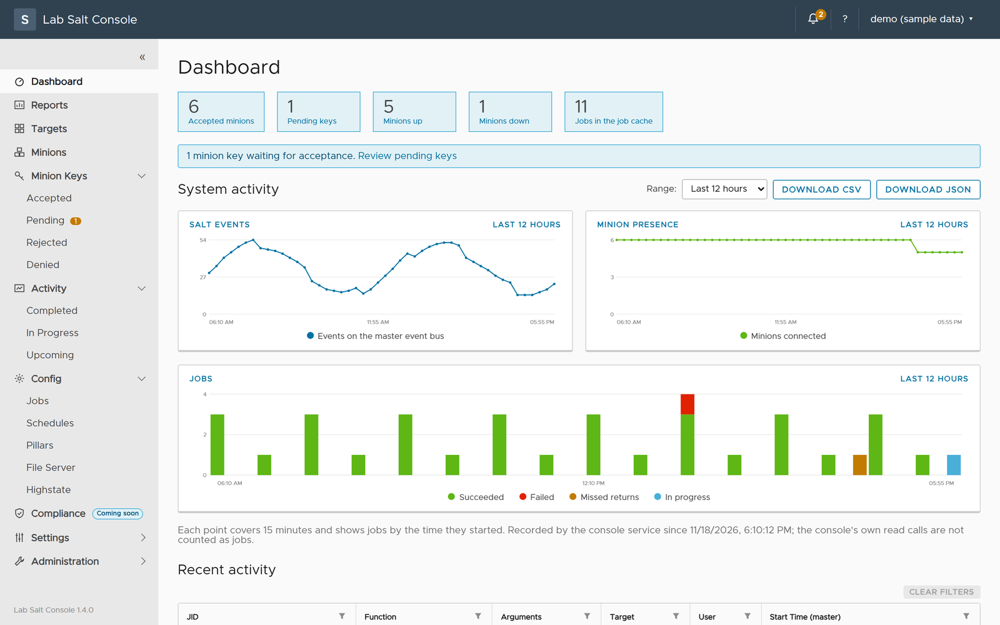
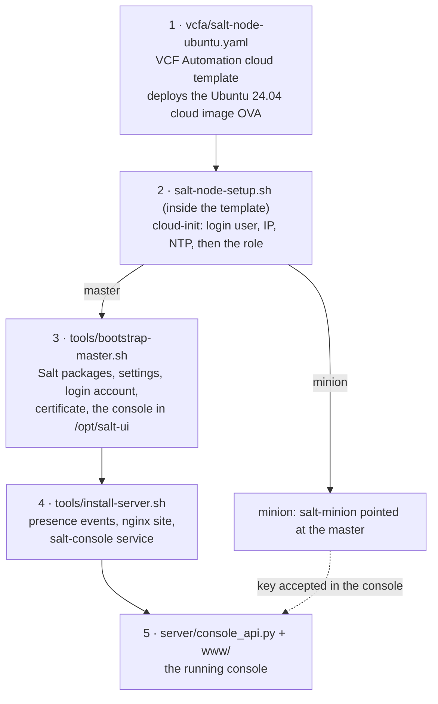
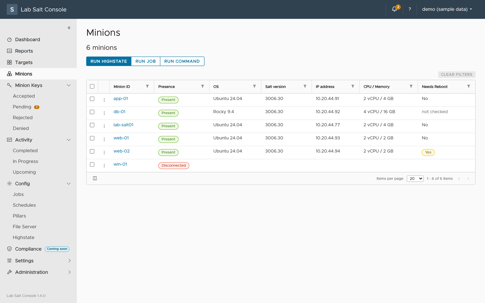
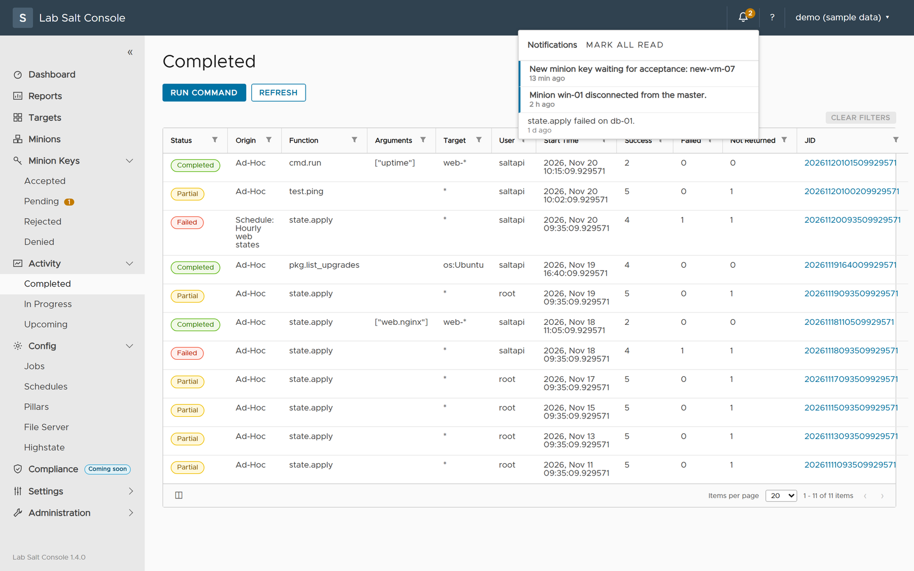
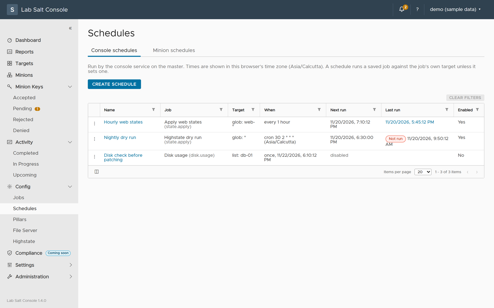
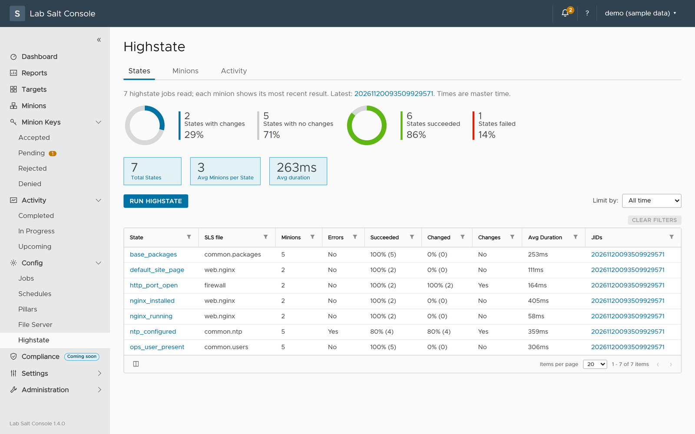

# Lab Salt Console

A web console for open source [Salt](https://saltproject.io/), styled after the Clarity design system, plus everything
needed to build the Salt VMs it runs on: a VCF Automation cloud template, a one-command installer and the console
service.



It is built for lab and proof-of-concept use. This is an independent project, not affiliated with, endorsed by or part
of VMware, Broadcom or the commercial Salt products. It follows the general layout of those consoles, on top of plain
open source Salt.

Current version: see [CHANGELOG.md](CHANGELOG.md). Tested with Salt 3006 LTS on Ubuntu 24.04, VCF Automation 9.1.

**Full guide with screenshots: [docs/SETUP.md](docs/SETUP.md)**

## How it fits together

The usual path starts in VCF Automation: one cloud template builds the master and the minions. Each step below hands
over to the next, and each one can also be run on its own.



## Quick start

### With VCF Automation (VCF Automation 9 VM Apps or Aria Automation 8.x)

1. Tag the network the VMs should use with a capability tag, e.g. `net:salt`.
2. Import [vcfa/salt-node-ubuntu.yaml](vcfa/salt-node-ubuntu.yaml) under **Design > Templates > New from > Upload**,
   set its `networkTag` default to your tag, version it and release it to the catalog.
3. Request it with **Salt role: Master**, a VM name, an IP and the passwords. About 2 to 6 minutes after the
   deployment completes, the console is at `https://<master ip>/`.
4. Request it again with **Salt role: Minion** and the master's IP for each minion, then accept their keys in the
   console under **Minion Keys > Pending**.

There is no VM template to prepare and no image mapping: the template deploys the Ubuntu cloud image OVA directly
(`imageRef`) and its cloud-init does the rest. The complete process, with screenshots, is in
[docs/SETUP.md, section 4](docs/SETUP.md#4-install-with-vcf-automation).

### On any Ubuntu 24.04 VM

```bash
curl -fsSLO https://raw.githubusercontent.com/imtrinity94/lab-salt-console/main/tools/bootstrap-master.sh
```

```bash
sudo API_PASSWORD='ChooseAStrongPassword1' bash bootstrap-master.sh
```

Then open `https://<vm ip>/` and log in as `saltapi`.

To explore every screen with sample data, without a login or a master behind it, open `https://<vm ip>/?demo=1`.

## What the console does

| Area | What you get | Backed by |
|---|---|---|
| Dashboard | Key and minion counts, recent jobs, and charts of Salt events, minion presence and job outcomes over 1 to 24 hours | salt-api, console service |
| Reports | Key state, minion version, OS version and Salt master version, each with a chart, table and CSV / JSON download | keys, grains |
| Targets | All Minions plus shared glob, list, grain and compound targets; Minions, Highstate, Activity and Edit tabs per target | grains, job cache, console service |
| Minions | Presence (Present / Disconnected / Unknown) and Needs Reboot; Details, Grains, Pillar, Packages, Activity and Targets tabs per minion | grains, `pillar.items`, `pkg.list_pkgs`, console service |
| Minion Keys | Accepted, Pending, Rejected and Denied; accept, reject and delete | wheel `key.*` |
| Activity | Completed (status, origin, Success / Failed / Not Returned), In Progress and Upcoming; a page per job with per-minion returns, JSON download and Stop Job | job cache, `saltutil.term_job`, console service |
| Jobs | Shared saved jobs: `salt` or `salt-run`, target, function, environment, states, arguments, pillar override, run as test | `local_async`, `runner_async`, console service |
| Schedules | Console schedules (recurring, once, or cron in their own time zone) that run saved jobs, with Run Now; minion-side schedules on a second tab | console service, `schedule.*` |
| Pillars / File Server | Pillar data per minion; browse, edit, rename and delete pillar and state files per saltenv | wheel `pillar_roots.*`, `file_roots.*` |
| Highstate | States, Minions and Activity tabs, Limit by period, a chart of runs with and without changes, state drill-down | job cache |
| Notifications | Bell listing failed jobs, new pending keys, minions that disconnect and schedules that could not run | console service |
| Settings | Theme, automatic logout, items per page, login banner, presence expiration, console service status | browser storage, files on the master |
| Administration | Audit log of jobs and runner / wheel calls with the Salt user, plus changes made in the console (kept 90 days) | console service |
| Compliance | Shown as Coming soon; not part of this version | |

| | |
|---|---|
|  |  |
|  |  |

## The scripts, in the order they run

### 1. `vcfa/salt-node-ubuntu.yaml`: the VCF Automation cloud template (the starting point)

One `Cloud.vSphere.Machine` on one `Cloud.vSphere.Network`:

- **Image**: `imageRef` is the Ubuntu 24.04 cloud image OVA URL (input **Ubuntu OVA URL**). There is no image
  mapping and no VM template.
- **Guest setup**: `customizeGuestOs: false`, so vSphere guest customization is skipped and cloud-init in the image
  configures the VM from the template's `cloudConfig`.
- **Size**: `bootDiskCapacityInGB` sets the disk (the image's root file system grows to fill it), plus vCPUs and
  memory.
- **Network**: chosen by its capability tag (input **Network**).
- **Inputs**: the role (master or minion), VM name, optional static IP / gateway / DNS / NTP, the OS login, the Salt
  version pin, the console login (master), the master's address (minion), and the console version, a git branch or
  tag.

The `cloudConfig` writes four files and runs one of them:

| File in the VM | Purpose |
|---|---|
| `/root/salt-install.env` | The request inputs, readable by root only. Passwords are not kept in it after the install. |
| `/usr/local/sbin/salt-status.sh` | Writes each step to `/var/log/salt-install.log` and to the VM's advanced setting `guestinfo.salt.status`, so progress shows in vCenter without logging in. |
| `/usr/local/sbin/salt-node-setup.sh` | The setup script described in step 2. |
| `/etc/ssh/sshd_config.d/01-password-auth.conf` | Enables SSH password login for the OS user. |

The deployment's **Overview** tab shows the role, size, IP address, console address and SSH command.

### 2. `salt-node-setup.sh` (inside the template): first-boot setup

Run once by cloud-init. It reports four steps:

1. **Login user**: creates the OS user, adds it to `sudo`, and sets its password.
2. **Network**: when a static IP was given, writes `/etc/netplan/60-static.yaml` (address, gateway, DNS, search
   domain), stops cloud-init from managing the network, and applies it. Otherwise it leaves the network as provided.
   It then waits until `github.com` resolves.
3. **Time**: points `systemd-timesyncd` at the NTP servers, when any were given.
4. **Salt**:
   - **master**: downloads `tools/bootstrap-master.sh` for the chosen console version and runs it with the
     console user and password, Salt version pin and minion ID;
   - **minion**: adds the Salt package repository and version pin, writes `master:` and `id:` to
     `/etc/salt/minion.d/lab.conf`, installs and starts `salt-minion`. The key then waits on the master to be
     accepted.

### 3. `tools/bootstrap-master.sh`: turn an Ubuntu 24.04 VM into a master with the console

Used by the template for a master, and on its own on any Ubuntu 24.04 VM (see Quick start). Run as root. It is safe
to run again: settings, the certificate, the password and console data that already exist are kept. Its log is
`/var/log/salt-console-bootstrap.log`.

| Step | What it does |
|---|---|
| 1/8 Salt package repository | Adds the Broadcom-hosted Salt repository key and `salt.sources`, pins `salt-*` to `SALT_PIN` (default `3006.*`) |
| 2/8 Packages | `salt-master`, `salt-api`, `salt-minion`, `nginx`, `git`, `nodejs` (Node.js only for the release checks) |
| 3/8 Console files | `git clone` of this repository (`REPO_REF`, default `main`) into `/opt/salt-ui`; an existing non-git folder is moved aside |
| 4/8 Master settings | `/etc/salt/master.d/lab.conf` from `master-lab.conf` with your login user; the master's own minion points at `127.0.0.1`; a sample state `lab.motd` |
| 5/8 Login account | A local account with no shell for PAM login; the password is the one given or a random one, saved in `/root/.salt-api-credentials` |
| 6/8 TLS certificate | Self-signed, for the host name and IP, at `/etc/ssl/certs/salt-ui.crt` and `/etc/ssl/private/salt-ui.key` |
| 7/8 Salt services | Enables and starts salt-master, salt-api and salt-minion, and accepts the master's own minion key |
| 8/8 Console service | Runs `tools/install-server.sh` (step 4), then checks the local minion and a salt-api login |

Settings come from environment variables: `API_USER`, `API_PASSWORD`, `SALT_PIN`, `MINION_ID`, `REPO_URL`, `REPO_REF`.

### 4. `tools/install-server.sh`: install or update the console service

Run as root, after the first install and again after every change under `server/` (bootstrap step 8 runs it for
you). It only restarts what changed:

- `server/master-console.conf` goes to `/etc/salt/master.d/console.conf` (`presence_events: True`). salt-master and
  salt-api are restarted only if the file changed.
- `server/nginx-salt-ui.conf` goes to `/etc/nginx/sites-available/salt-ui`, is enabled, and nginx's default site is
  removed. The site is checked with `nginx -t` and reloaded; if the check fails, the previous file is restored.
- `server/salt-console.service` goes to systemd and the service is restarted. The script then waits until
  `http://127.0.0.1:8001/health` answers.

### 5. The running console

**`server/console_api.py`** is the console service. It is a single Python file run by systemd as `salt-console`,
using the Python that ships with Salt (`/opt/saltstack/salt/bin/python3.11`), and it listens on `127.0.0.1:8001`
behind nginx at `/console-api/`. It keeps its data in `/var/lib/salt-console/console.db` (SQLite). It has three
background threads:

- **event loop**: reads the master's event bus and records presence, job outcomes, the audit trail and notifications;
- **scheduler**: every 10 seconds, starts console schedules that are due, through Salt's LocalClient or RunnerClient;
- **retention**: hourly, removes data past its retention period.

Its HTTP routes cover login (`/login` issues a Salt eauth token), shared targets and jobs (versioned, so a stale
write is refused), settings, presence, schedules, Upcoming, job origins, notifications, the audit log, the dashboard
metrics, and `/health`.

**`www/`** is the web console: plain HTML, CSS and JavaScript with no build step, loaded in the order listed in
`tools/scripts.txt`.

| Script | Role |
|---|---|
| `app.js` | Core: version, salt-api calls (`raw()`), login, hash routing, page framework, Dashboard, Minion Keys, Activity, job pages, Pillars and File Server |
| `net.js` | Request discipline for salt-api: runner and wheel calls are sent one at a time (salt-api fails on parallel ones), read-only calls are retried once, finished job results are cached |
| `grid.js` | The datagrid used by every table: sorting, column filters, paging, show / hide columns, row selection, menus and expanding rows |
| `demo.js` | Sample data mode (`?demo=1`): answers every call from built-in data, so nothing reaches Salt |
| `shell.js` | Header menus, navigation icons, collapsible navigation, and `addNav()` for the feature modules |
| `highstate.js` | Highstate workspace from the job cache: Limit by, States / Minions / Activity tabs, trend chart, state drill-down |
| `targets.js` | Targets list and target pages (Minions / Highstate / Activity / Edit) |
| `jobs.js` | Saved job definitions (`salt` and `salt-run`), running them, job download and Stop Job, and Success / Failed / Not Returned counts on Activity |
| `minions.js` | Minions list, minion pages, presence pills, Needs Reboot, and Reports |
| `settings.js` | User Preferences, Login Banner, and the File Server / Pillar saltenv selector, rename and delete |
| `console.js` | Client for the console service: second login, shared targets and jobs, presence, notifications bell, dashboard charts, schedules, Upcoming, job origins, Audit Log, Console Service settings, Compliance page |
| `boot.js` | Loaded last; starts routing once every module has registered |

`index.html` loads them, and `app.css` holds the styling (light and dark).

### Configuration files

| File | Installed as | Contents |
|---|---|---|
| `master-lab.conf` | `/etc/salt/master.d/lab.conf` | `user: root` (PAM needs it), `auto_accept: False`, file and pillar roots, PAM external auth for the login user, the netapi clients the console uses, rest_cherrypy on `127.0.0.1:8000` without TLS, 30-day job retention |
| `server/master-console.conf` | `/etc/salt/master.d/console.conf` | `presence_events: True` |
| `server/nginx-salt-ui.conf` | `/etc/nginx/sites-available/salt-ui` | HTTPS on 443 (80 redirects), web root `/opt/salt-ui/www`, `/salt-api/` to port 8000, `/console-api/` to port 8001 |
| `server/salt-console.service` | `/etc/systemd/system/salt-console.service` | Runs the console service as root with Salt's Python and restarts it on failure |

### Development and release scripts

| Script | What it does |
|---|---|
| `tools/release.sh <version>` | Sets the version, rebuilds the script tags in `index.html` from `tools/scripts.txt`, merges `CHANGELOG.new` into `CHANGELOG.md`, runs every check below, then commits, tags and pushes. It stops on any failure, or if the running service is older than `server/console_api.py`. |
| `tools/scripts.txt` | Load order of the `www/` scripts |
| `test/smoke.js` | Renders every page outside a browser: `DEMO=1 node test/smoke.js` on sample data, `API_PW=... node test/smoke.js` against the live master |
| `test/extra.json` | Extra pages (tabs and sub-pages) for the smoke test |
| `test/api_test.py` | 13 end-to-end checks of the console service through nginx: auth, event bus, presence, shared lists, schedules (recurring, cron, Run Now, the scheduler itself), audit, notifications, metrics. It removes everything it creates. |

## How the console service works

- **Login.** One login form signs you in to salt-api and to the console service. The service checks the same PAM
  password through Salt's external auth and issues a Salt eauth token, which it checks against the master's token
  store on every request.
- **Presence.** With `presence_events: True`, the master reports its connected minions every 60 seconds. A minion is
  **Present** if it was reported connected, or returned job data, within the presence expiration (default 300
  seconds), **Disconnected** if it was seen before but not since, and **Unknown** if it has never been seen.
- **Schedules.** A due run publishes the saved job as root, so the job cache shows the user `root`; the Origin column
  and the audit log name the schedule that started it. A run found more than 5 minutes late (because the service was
  down) is skipped and recorded, never started late.
- **Read calls are not jobs.** The console's own page reads, and the pings that `manage.status` sends, are left out
  of the audit log, job metrics and notifications.
- **Retention.** Event and presence counts, job outcomes, schedule runs and notifications are kept for 30 days; the
  audit log for 90 days.
- **If the service is down,** everything that talks directly to Salt keeps working, and pages that need the service
  say so.

## Known limits

- There is no role-based access control: whoever logs in gets the rights the master's `external_auth` gives that
  user. It is meant for POCs only.
- The service runs as root and its code lives in `/opt/salt-ui`, so anyone who can write there can change what runs
  as root.
- The Compliance and Vulnerability content of commercial consoles (CIS / STIG benchmarks, vendor advisory feeds) is
  licensed and not included.

## Repository layout

```
vcfa/salt-node-ubuntu.yaml VCF Automation / Aria Automation cloud template (master with the console, or minion)
tools/bootstrap-master.sh  turns an Ubuntu 24.04 VM into a Salt master running the console
tools/install-server.sh    installs or updates the console service, nginx site and master setting
server/console_api.py      the console service
server/*.conf, *.service   nginx site, master setting and systemd unit
www/                       the web console (load order in tools/scripts.txt)
master-lab.conf            Salt master settings used by the install
test/                      smoke test, its extra pages, console service checks
tools/release.sh           release script
docs/SETUP.md              setup and operations guide; screenshots in docs/images
CHANGELOG.md               every release, newest first
```

## Releasing

Releases are made on the master; see [docs/SETUP.md, section 11](docs/SETUP.md#11-develop-and-release). In short,
write the notes in `CHANGELOG.new`, then run:

```bash
API_PW='<console password>' bash tools/release.sh <version>
```

Versions follow semantic versioning: a minor version for new features, a patch version for fixes.
