# Setting up the Lab Salt Console

This guide takes you from an empty Ubuntu 24.04 VM to a working Salt master with the console. It covers adding
minions, a tour of the console, day-to-day upkeep, troubleshooting, and how to release a new version.

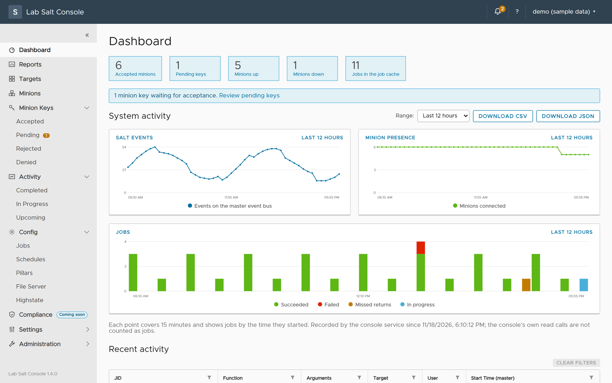

- [1. What gets installed](#1-what-gets-installed)
- [2. Requirements](#2-requirements)
- [3. Install: one command on a fresh VM](#3-install-one-command-on-a-fresh-vm)
- [4. Install with VCF Automation](#4-install-with-vcf-automation)
- [5. Install: step by step](#5-install-step-by-step)
- [6. First login and a tour](#6-first-login-and-a-tour)
- [7. Add minions](#7-add-minions)
- [8. Day-to-day upkeep](#8-day-to-day-upkeep)
- [9. Troubleshooting](#9-troubleshooting)
- [10. Uninstall](#10-uninstall)
- [11. Develop and release](#11-develop-and-release)

## 1. What gets installed

Everything runs on the Salt master. nginx is the only part that listens on the network (ports 80 and 443). Salt
itself uses 4505 and 4506 for its minions.

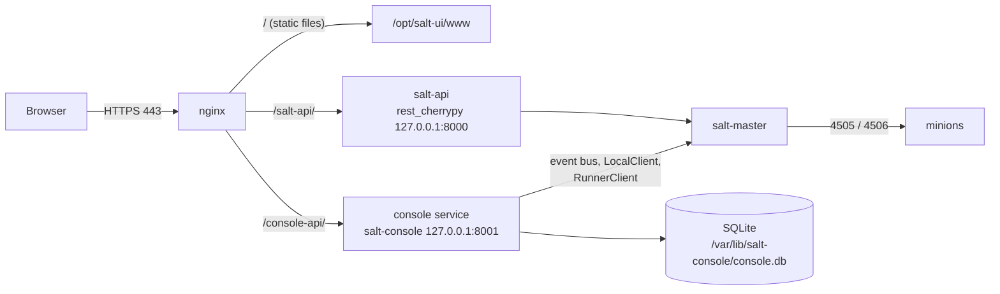

| Piece | Where | What it does |
|---|---|---|
| Console (static pages) | `/opt/salt-ui/www` | The web UI. Everything that reads or changes Salt goes to salt-api, so Salt checks what each user may do. |
| salt-api | `127.0.0.1:8000`, PAM login | Salt's REST API (rest_cherrypy). |
| Console service | `/opt/salt-ui/server/console_api.py`, unit `salt-console` | Records events, presence and job outcomes; keeps saved targets, jobs, settings, audit log and notifications; runs console schedules. Runs with the Python that ships with Salt. |
| nginx | `/etc/nginx/sites-available/salt-ui` | TLS, the web root, and the `/salt-api/` and `/console-api/` routes. |
| Salt settings | `/etc/salt/master.d/lab.conf`, `/etc/salt/master.d/console.conf` | External auth (PAM), netapi clients, rest_cherrypy, job retention, presence events. |

## 2. Requirements

- A VM with **Ubuntu 24.04**: 2 vCPU, 2 GB RAM and a 20 GB disk are plenty for a lab.
- A static IP and working DNS. The install downloads from `packages.broadcom.com`, `github.com` and the Ubuntu
  mirrors.
- Root access (sudo).
- Open ports: **443** (and 80, which redirects to 443) for browsers; **4505 and 4506** for minions.

## 3. Install: one command on a fresh VM

Log in to the new VM and run:

```bash
curl -fsSLO https://raw.githubusercontent.com/imtrinity94/lab-salt-console/main/tools/bootstrap-master.sh
```

```bash
sudo API_PASSWORD='ChooseAStrongPassword1' bash bootstrap-master.sh
```

This takes 3 to 5 minutes and ends with:

```
Done. Salt 3006.x, local minion [<name>: True], salt-api login HTTP 200
Console:  https://<ip>/   (user saltapi, password in /root/.salt-api-credentials)
```

What the script does, in order. The full log is in `/var/log/salt-console-bootstrap.log`.

1. Adds the Salt package repository and pins `salt-*` to the 3006 LTS line.
2. Installs `salt-master`, `salt-api`, `salt-minion`, `nginx`, `git` and `nodejs`. Node.js is only needed for the
   release checks.
3. Clones this repository into `/opt/salt-ui`. If that folder already exists and is not a git checkout, it is moved
   aside first.
4. Writes `/etc/salt/master.d/lab.conf` from [master-lab.conf](../master-lab.conf), with your login user, and
   points the master's own minion at itself.
5. Creates the login account (no shell) and stores its password in `/root/.salt-api-credentials`, readable by root only.
6. Creates a self-signed TLS certificate for the host name and IP.
7. Starts Salt and accepts the master's own minion key.
8. Runs [tools/install-server.sh](../tools/install-server.sh). This adds the presence events setting, the nginx
   site and the `salt-console` service, then waits until the service answers.

Optional settings, passed the same way as `API_PASSWORD`:

| Variable | Default | Meaning |
|---|---|---|
| `API_USER` | `saltapi` | Account you log in with |
| `API_PASSWORD` | generated | Its password. If you leave it out, a random one is written to `/root/.salt-api-credentials` |
| `SALT_PIN` | `3006.*` | Salt version line. Empty means the newest version |
| `MINION_ID` | short host name | ID of the master's own minion |
| `REPO_REF` | `main` | Branch or tag to install, for example `v1.4.1` |

You can run the script again safely. It keeps existing settings, the certificate, the password (unless you pass a
new one) and the console data.

## 4. Install with VCF Automation

If you run **VCF Automation 9** (a VM Apps organization) or **Aria Automation 8.x**, the cloud template
[vcfa/salt-node-ubuntu.yaml](../vcfa/salt-node-ubuntu.yaml) builds everything from the catalog. Each request deploys
one VM straight from the **Ubuntu 24.04 cloud image OVA**, which becomes either:

- **a master**: Salt master, salt-api, its own minion, nginx and the console, installed by cloud-init running
  [tools/bootstrap-master.sh](../tools/bootstrap-master.sh) from this repository; or
- **a minion**: `salt-minion`, pointed at the master you give it.

You don't need to prepare a VM template or create an image mapping: VCF Automation downloads the OVA and the image's
own cloud-init does the rest. You also don't need any Orchestrator workflows, ABX actions or subscriptions.

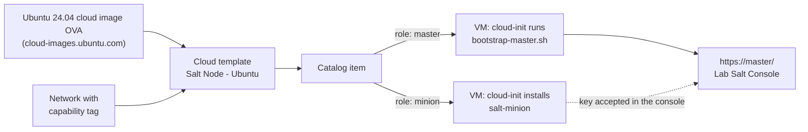

### 4.1 What you need

| Item | Notes |
|---|---|
| vCenter cloud account and a cloud zone | Already set up in most environments. The zone must be added to the project you use. |
| A project | You must be a member, and the project must include the cloud zone. |
| A network with a capability tag | The VMs connect to it. The template's default tag is `net:salt`. |
| A storage profile | Any profile valid in the cloud zone. |
| Access to the OVA | VCF Automation downloads `https://cloud-images.ubuntu.com/noble/current/noble-server-cloudimg-amd64.ova` (about 600 MB) at deployment time. Without internet access, put the OVA on an internal web server and change the template's **Ubuntu OVA URL** default to it. |
| Outbound internet from the VMs | To `packages.broadcom.com`, `github.com`, `raw.githubusercontent.com` and the Ubuntu mirrors, directly or through a proxy. |
| IP addresses | One per VM: a static address typed into the request form, or DHCP / the network profile's IP range. |

### 4.2 Tag the network

Go to **Infrastructure > Resources > Networks**, select the network the VMs should use, click **Tags**, and add the
capability tag `net:salt` (or your own, and put that in the template). The network must belong to a network profile
for the cloud zone's region. A tag on the network profile works as well.

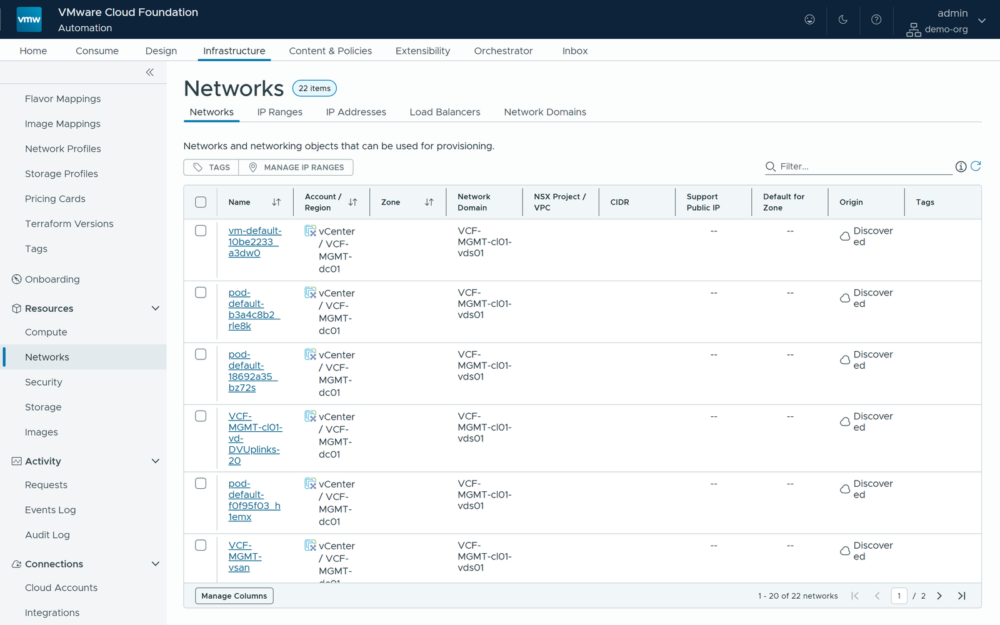

The template applies IP settings inside the guest, so:

- if you type a static IP into the request form, the network needs neither an IP range nor DHCP;
- if you leave the IP empty, the VM keeps whatever address DHCP or the network profile gives it.

### 4.3 Import the cloud template

1. Download the template file:

   ```bash
   curl -fsSLO https://raw.githubusercontent.com/imtrinity94/lab-salt-console/main/vcfa/salt-node-ubuntu.yaml
   ```

2. Go to **Design > Templates** (the **Blueprints** page) and choose **New from > Upload**.
   - **Name**: e.g. `Salt Node - Ubuntu`, or your own naming convention. In the author's lab it is
     `LAB - Salt Node - Ubuntu`.
   - **Project**: your project.
   - **File**: `salt-node-ubuntu.yaml`.

   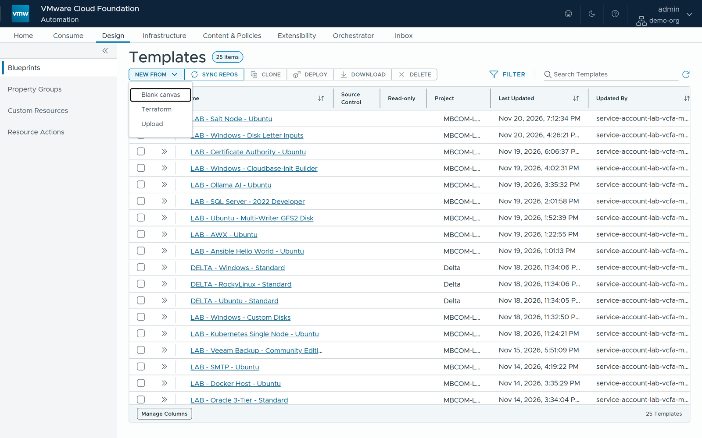

3. Open the template and change the `networkTag` default (marked `CHANGE`) to your network's tag. You may also want
   to set defaults for the DNS servers, DNS domain, gateway, prefix length, NTP servers, the Salt version and the OVA
   URL.

   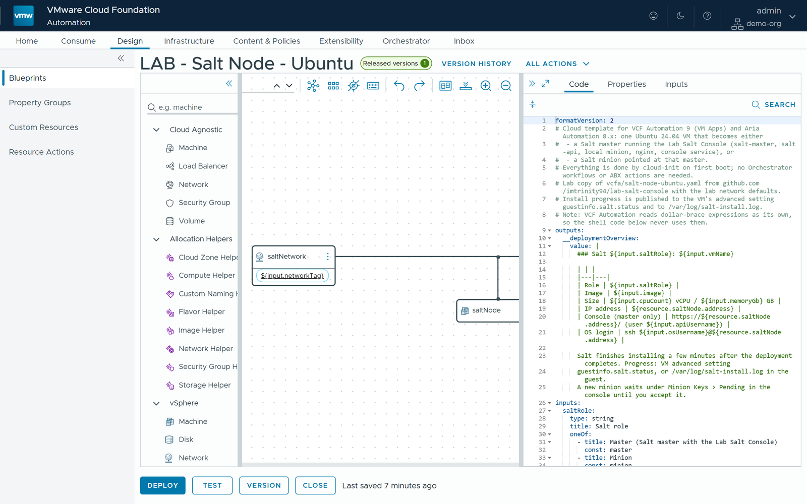

4. Click **Test** and enter a VM name and an OS password. The test should end with **Successful**. If it reports
   *No matching network*, no network in the project's cloud zones has the tag.
5. Click **Version**, enter `1.0.0`, tick **Release this version to the catalog**, and click **Create**.

### 4.4 Publish to the catalog

1. Go to **Content & Policies > Content Sources > New > Template**. Choose the project, click **Validate**, then
   **Create & Import**. If the project already has a template content source, open it and click **Save & Import**
   so it picks up the new template.

   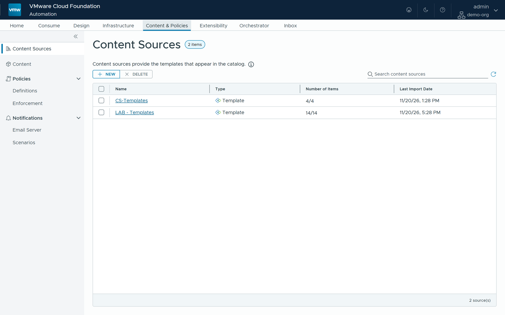

2. Go to **Content & Policies > Policies > Definitions > New Policy > Content Sharing Policy**. Scope it to the
   project, add the content source (or only this template), and add the users or groups who may request it. Skip
   this step if a sharing policy already covers the content source.
3. **Consume > Catalog** now shows **Salt Node - Ubuntu**.

### 4.5 Request the master

In **Consume > Catalog**, click **Request** on **Salt Node - Ubuntu** and fill in:

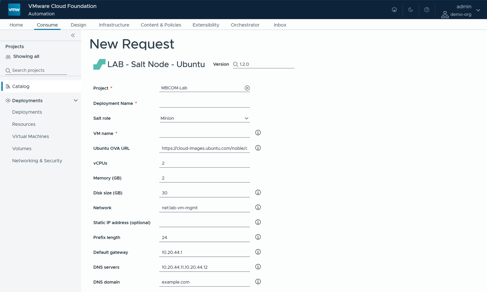

| Input | Value for the master |
|---|---|
| Salt role | **Master (Salt master with the Lab Salt Console)** |
| VM name | e.g. `salt01`. This is also the host name and the master's minion ID. |
| Ubuntu OVA URL | leave the default, or your internal copy |
| vCPUs / Memory (GB) / Disk size (GB) | 2 / 2 / 30 is enough for a lab. Use 4 GB of memory for more than about 50 minions. |
| Network | the capability tag (default from the template) |
| Static IP address, prefix length, gateway, DNS servers, DNS domain | the master's address. Leave the IP empty to use DHCP or the network profile. |
| NTP servers | optional |
| OS login user / password | your SSH login to the VM (sudo) |
| Salt version | `3006.*` (LTS) unless you need another |
| Console user / password | the console login (default user `saltapi`). Leave the password empty to have one generated. |
| Console version | `main`, or a release tag such as `v1.4.1` |

VCF Automation marks the deployment complete as soon as the VM is up; Salt and the console then take another 2 to 6
minutes inside the guest. The first deployment also waits for the OVA to download. The deployment's **Overview**
tab shows the console address:

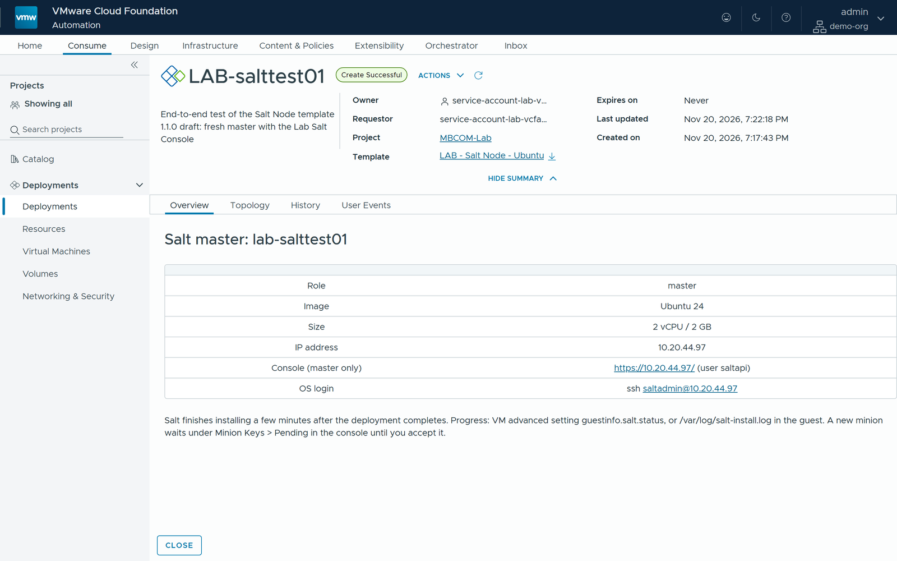

### 4.6 Follow the install

The VM reports each step to the advanced setting `guestinfo.salt.status`. To see it in vCenter, open the VM and go
to **Configure > Settings > VM Options > Advanced > Edit Configuration Parameters**, then filter on
`guestinfo.salt`. Or watch it in the guest:

```bash
sudo tail -f /var/log/salt-install.log
```

| Status | Meaning |
|---|---|
| `1/4 login user ... ready` | The OS login user exists. |
| `2/4 static IP ...` or `2/4 network left as provided` | The network is configured. |
| `3/4 time sync: ...` | NTP is set. |
| `4/4 installing the Salt master and the Lab Salt Console` | The bootstrap is running. Its full log is `/var/log/salt-console-bootstrap.log`. |
| `4/4 done: Salt master with the console at https://<ip>/` | Finished. Open the address and log in. |
| `4/4 FAILED ...` | Read the log it names, and see [4.9](#49-troubleshooting-the-vcf-automation-install). |

The console password is in `/root/.salt-api-credentials` on the master: either the one you entered, or the one that
was generated.

### 4.7 Request minions

Request **Salt Node - Ubuntu** again:

- **Salt role**: **Minion**;
- **Salt master address**: the master's IP;
- a new **VM name** and IP.

The status ends with `4/4 done: minion <name> ... waiting for its key to be accepted`. The key then appears in the
console under **Minion Keys > Pending**, and the bell shows a notification. Accept it, and within a minute the
minion is listed under **Minions** as Present. For machines that weren't built from the template, see
[7. Add minions](#7-add-minions).

### 4.8 Updating a master built from the template

The template installs the console from git into `/opt/salt-ui`, so updates work exactly as in
[8.1](#81-update-to-a-new-version). To build new masters with a newer console, set **Console version** to the new
tag when you request them.

### 4.9 Troubleshooting the VCF Automation install

| Symptom | Cause and fix |
|---|---|
| The request fails while cloning the image or downloading the OVA | VCF Automation can't reach the OVA URL. Host the OVA internally and change the **Ubuntu OVA URL**. |
| Request fails with "No matching network" | No network in the project's cloud zones has the tag in **Network**. |
| `guestinfo.salt.status` never appears and `/var/log/salt-install.log` is missing | cloud-init didn't receive the configuration. On the VM, check `sudo cloud-init status --long` and `/var/log/cloud-init.log`. Make sure the template still has `customizeGuestOs: false`. |
| The status stops at `2/4` | The static IP, gateway or DNS is wrong, so the VM can't reach `github.com`. Check `/etc/netplan/60-static.yaml` and `getent hosts github.com`. |
| `4/4 FAILED cannot download bootstrap-master.sh` | There's no internet or proxy access, or **Console version** isn't an existing branch or tag. |
| `4/4 FAILED: see /var/log/salt-console-bootstrap.log` | Read that log; it is usually a package download failure. Fix the cause, then run `sudo bash /root/bootstrap-master.sh` on the VM. It is safe to run again. |
| The minion never shows under Pending | The minion can't reach the master on TCP 4505 and 4506, or the master address is wrong. Check `/var/log/salt/minion` on the minion. |

## 5. Install: step by step

These are the same steps the bootstrap runs, if you'd rather do them yourself. Run them as root.

**Salt repository and packages**

```bash
install -d -m 755 /etc/apt/keyrings
curl -fsSL https://packages.broadcom.com/artifactory/api/security/keypair/SaltProjectKey/public -o /etc/apt/keyrings/salt-archive-keyring.pgp
curl -fsSL https://github.com/saltstack/salt-install-guide/releases/latest/download/salt.sources -o /etc/apt/sources.list.d/salt.sources
printf 'Package: salt-*\nPin: version 3006.*\nPin-Priority: 1001\n' > /etc/apt/preferences.d/salt-pin-1001
apt-get update
apt-get install -y salt-master salt-api salt-minion nginx git nodejs
```

**Console files and Salt settings**

```bash
git clone https://github.com/imtrinity94/lab-salt-console.git /opt/salt-ui
cp /opt/salt-ui/master-lab.conf /etc/salt/master.d/lab.conf
printf 'master: 127.0.0.1\nid: %s\n' "$(hostname -s)" > /etc/salt/minion.d/lab.conf
mkdir -p /srv/salt /srv/pillar
```

`master-lab.conf` gives the user `saltapi` full rights through PAM. To use another name, edit the line under
`external_auth: pam:`. It also turns on the netapi clients the console uses, runs rest_cherrypy on `127.0.0.1:8000`
without TLS (nginx handles TLS), and leaves `auto_accept` off.

**Login account**

```bash
useradd -M -s /usr/sbin/nologin saltapi
passwd saltapi
```

**TLS certificate** (self-signed; see [8.4](#84-replace-the-tls-certificate) to use a CA-signed one)

```bash
openssl req -x509 -nodes -newkey rsa:2048 -days 825 -subj "/CN=$(hostname -f)" \
  -addext "subjectAltName=DNS:$(hostname -f),IP:$(hostname -I | awk '{print $1}')" \
  -keyout /etc/ssl/private/salt-ui.key -out /etc/ssl/certs/salt-ui.crt
```

**Start Salt, accept the master's own minion, install the console service**

```bash
systemctl enable --now salt-master salt-api salt-minion nginx
salt-key -L
salt-key -y -a "$(hostname -s)"
bash /opt/salt-ui/tools/install-server.sh
```

`install-server.sh` ends by printing the service health, for example `{"ok": true, "version": "1.4.1", ...}`.

## 6. First login and a tour

Open `https://<master ip>/`. With the self-signed certificate the browser shows a warning the first time. Log in
with the account from the install.

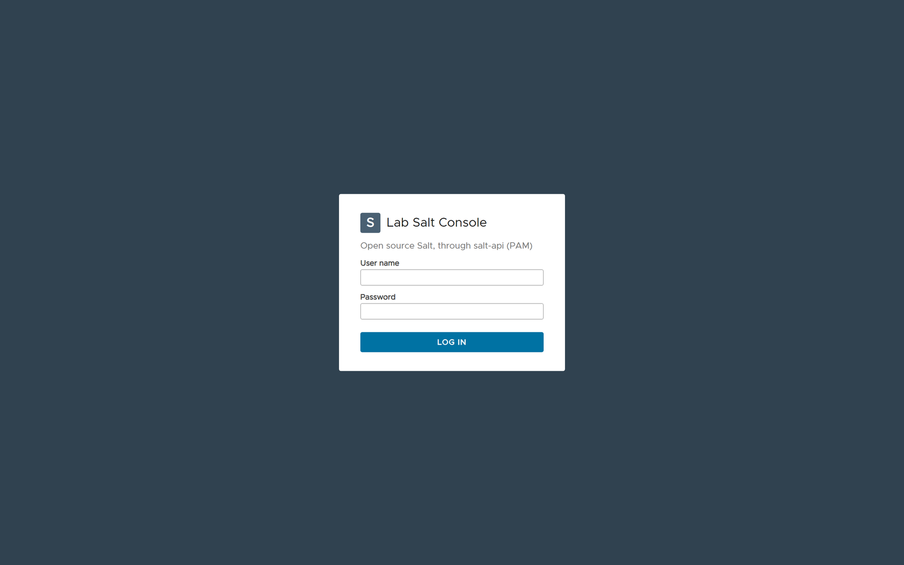

The one login signs you in to salt-api and to the console service. Both check the same PAM password.

**Try it without a master.** `https://<master ip>/?demo=1` opens every screen with built-in sample data. No login
is needed and nothing is sent to Salt. All the screenshots in this guide were taken in that mode.

### Dashboard

Counts of keys and minions, then three charts over 1 to 24 hours: Salt events, minion presence, and job outcomes
(succeeded, failed, missed returns, in progress). Each chart can be downloaded as CSV or JSON. Recent activity is
listed below the charts.

### Minions and keys

**Minions** lists every accepted minion with its presence:

- **Present**: seen within the presence expiration (default 300 seconds).
- **Disconnected**: seen before, but not since then.
- **Unknown**: never seen.

It also flags Debian and Ubuntu minions that need a reboot. Each minion has Details, Grains, Pillar, Packages,
Activity and Targets tabs.

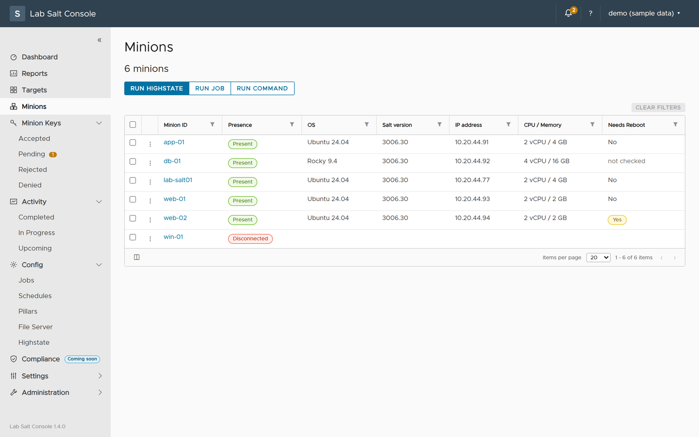

**Minion Keys** has tabs for Accepted, Pending, Rejected and Denied keys. New minions wait under Pending until
you accept them.

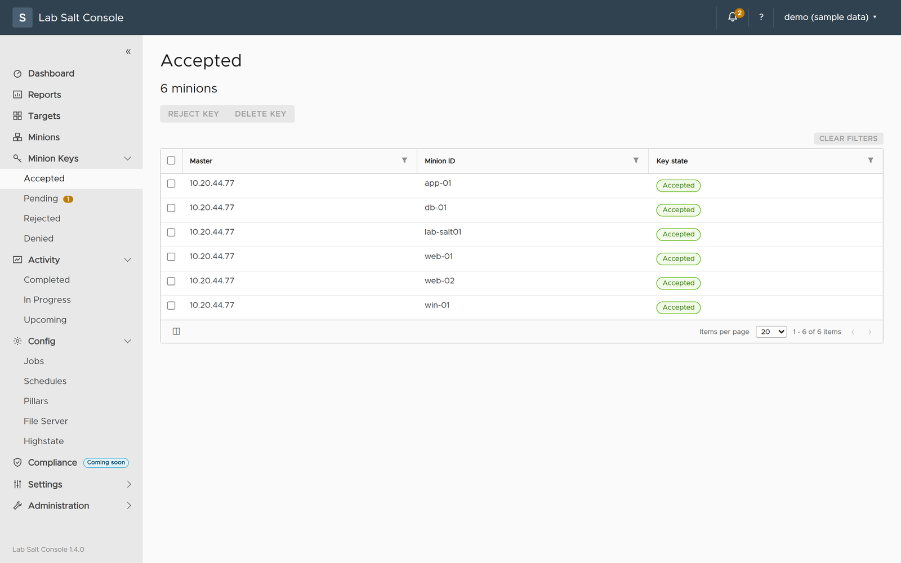

### Targets

Saved groups of minions: glob, list, grain or compound. Each target has Minions, Highstate, Activity and Edit tabs.
Targets are stored on the master, so everyone using the console sees the same list.

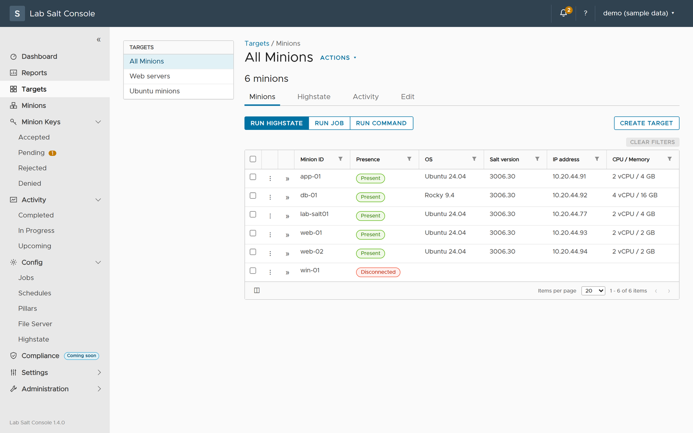

### Jobs, schedules and activity

**Config > Jobs** stores reusable job definitions. A job is either `salt` (runs on minions) or `salt-run` (runs on
the master), with a target, function, environment, states, arguments, a pillar override, and an option to run as a
test.

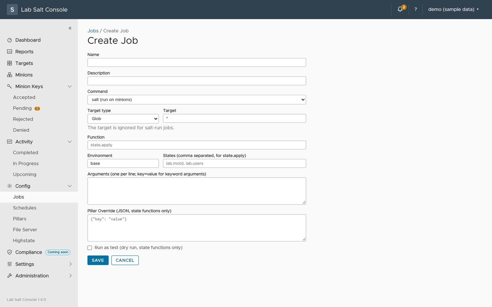

**Config > Schedules** runs saved jobs on a schedule:

- **Recurring**: every N minutes, optionally within a start and end time.
- **Once**: at one set time.
- **Cron**: a five-field cron expression, evaluated in the schedule's own time zone.

**Run Now** starts a schedule straight away. The second tab lists schedules defined on the minions themselves.

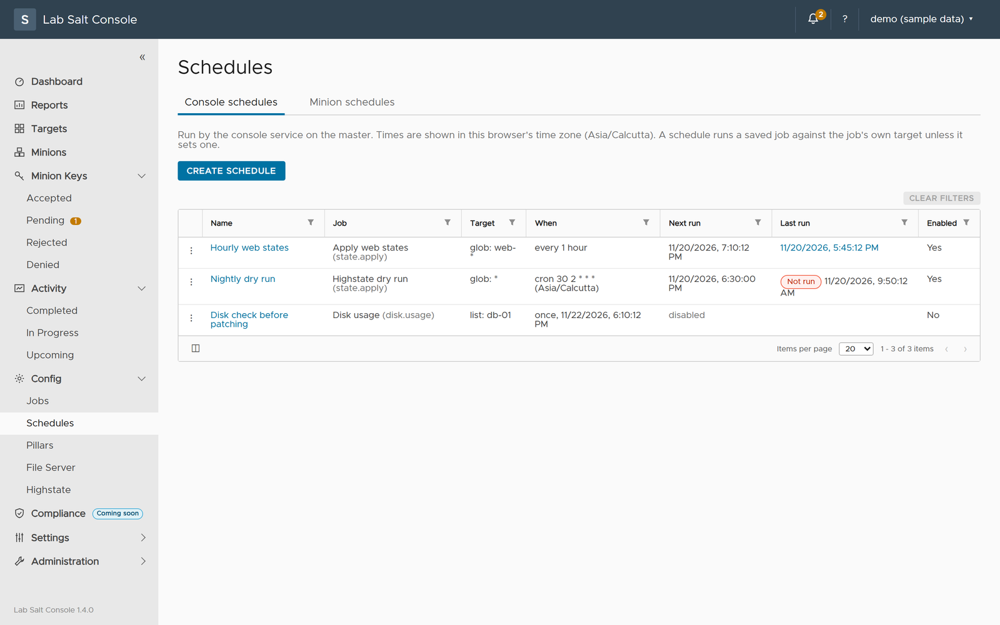

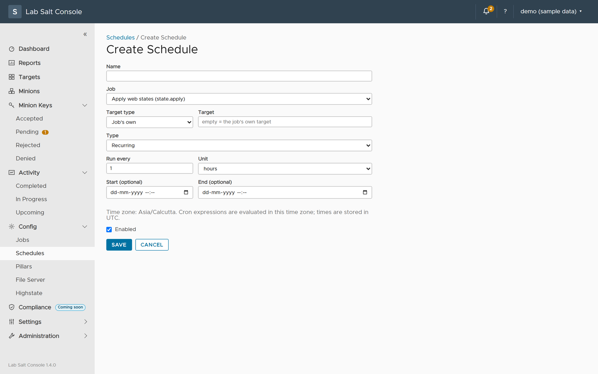

**Activity** has three pages:

- **Completed**: every job with its status, its origin (`Schedule: <name>` or `Ad-Hoc`), and per-minion success,
  failure and no-return counts.
- **In Progress**: jobs still running. You can stop one from its job page.
- **Upcoming**: schedule runs due in the next 7 days.

The bell in the header lists failed jobs, new pending keys, minions that disconnect, and schedules that could not run.

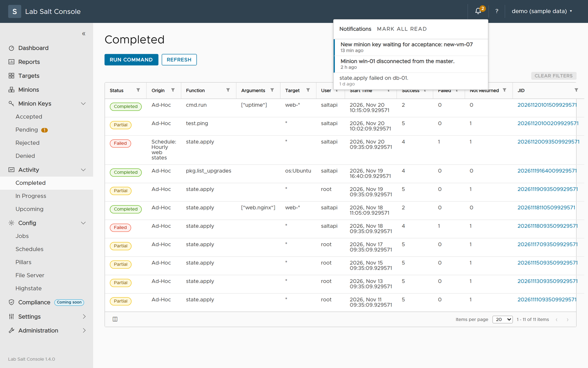

### Highstate, pillars and files

**Highstate** has States, Minions and Activity tabs, a chart comparing runs with and without changes, and a detail
page for each state. **Pillars** and **File Server** let you browse and edit `/srv/pillar` and `/srv/salt` for each
saltenv.

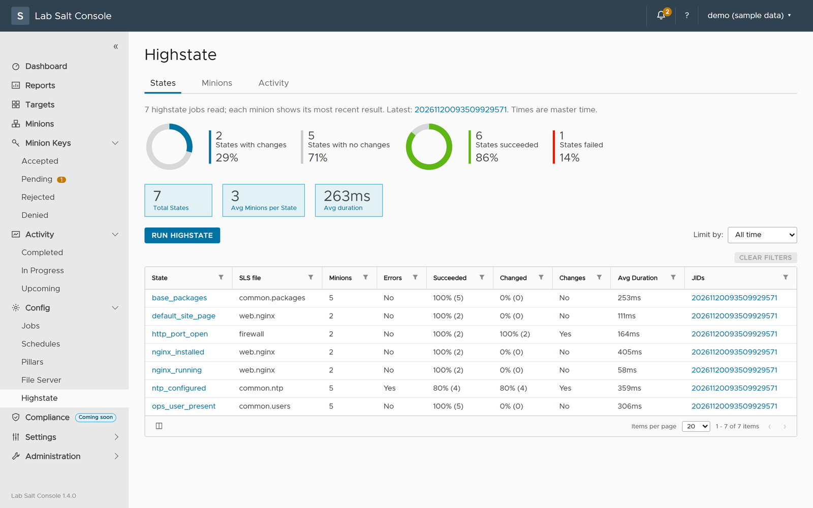

### Administration and settings

**Administration > Audit Log** records every job and runner or wheel call with the Salt user who made it, plus
changes made in the console. Entries are kept for 90 days.

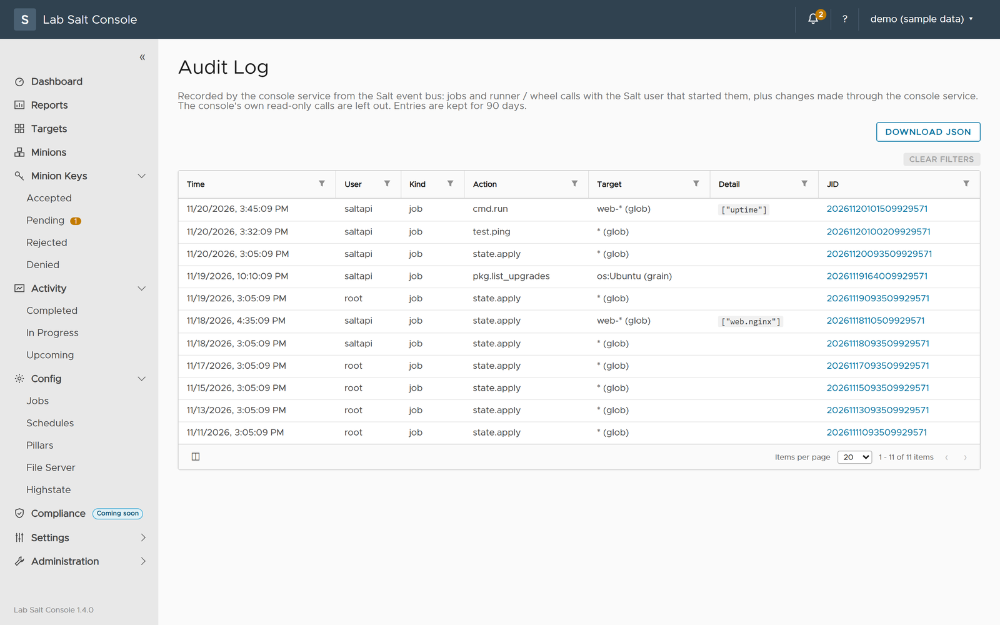

**Settings** has three tabs:

- **User Preferences**: theme, automatic logout and items per page.
- **Login Banner**: text shown on the login page.
- **Console Service**: service status, event bus connection and the presence expiration.

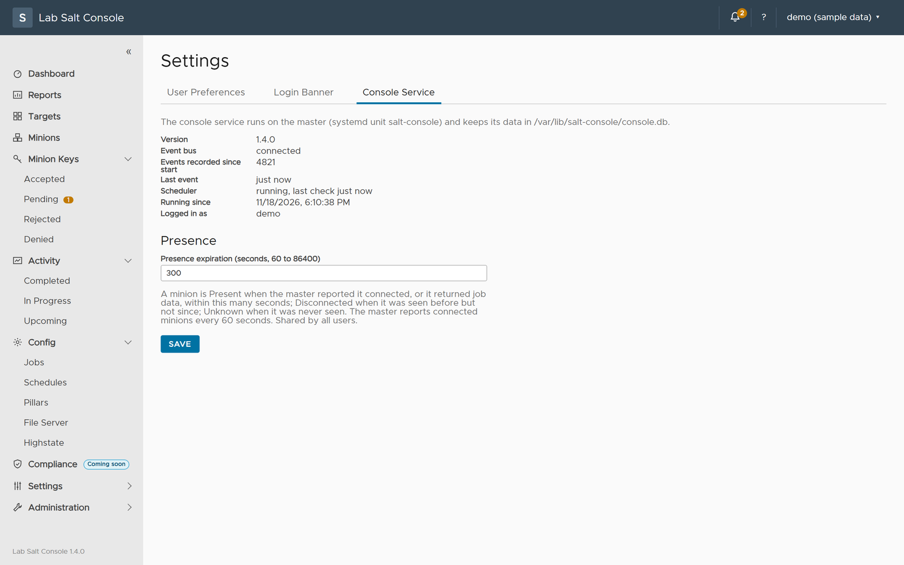

## 7. Add minions

On each new machine, install the minion and point it at the master. This example is for Ubuntu or Debian. On
Rocky or RHEL, use the `salt.repo` file from the same Salt install guide.

```bash
install -d -m 755 /etc/apt/keyrings
curl -fsSL https://packages.broadcom.com/artifactory/api/security/keypair/SaltProjectKey/public -o /etc/apt/keyrings/salt-archive-keyring.pgp
curl -fsSL https://github.com/saltstack/salt-install-guide/releases/latest/download/salt.sources -o /etc/apt/sources.list.d/salt.sources
printf 'Package: salt-*\nPin: version 3006.*\nPin-Priority: 1001\n' > /etc/apt/preferences.d/salt-pin-1001
apt-get update && apt-get install -y salt-minion
printf 'master: <master ip>\nid: %s\n' "$(hostname -s)" > /etc/salt/minion.d/lab.conf
systemctl enable --now salt-minion
systemctl restart salt-minion
```

The key then appears under **Minion Keys > Pending**, and the bell shows a notification. Select it and click
**Accept**. To do the same from the master's shell:

```bash
sudo salt-key -a <minion id>
```

To check that it answers, try **Run Command** on the Completed page with function `test.ping`, or run this on the
master:

```bash
sudo salt '<minion id>' test.ping
```

The sample state from the install applies a message of the day:

```bash
sudo salt '<minion id>' state.apply lab.motd
```

## 8. Day-to-day upkeep

### 8.1 Update to a new version

```bash
cd /opt/salt-ui
sudo git pull
sudo bash tools/install-server.sh
```

Reload the browser page. The version is shown at the bottom of the navigation. `install-server.sh` restarts the
console service every time, but only restarts salt-master, salt-api and nginx when their settings changed. To move
to a specific release, use `sudo git checkout v1.4.1` instead of `git pull`.

### 8.2 Back up and restore the console data

All console data lives in one SQLite file: saved targets and jobs, schedules, settings, the audit log,
notifications and chart history. Salt's own data (keys, the job cache, `/srv`) is separate, so back up `/etc/salt`
and `/srv` as well.

```bash
sudo /opt/saltstack/salt/bin/python3.11 -c "import sqlite3; s=sqlite3.connect('/var/lib/salt-console/console.db'); d=sqlite3.connect('/root/console-backup.db'); s.backup(d)"
```

To restore:

```bash
sudo systemctl stop salt-console
sudo cp /root/console-backup.db /var/lib/salt-console/console.db
sudo systemctl start salt-console
```

### 8.3 Change the login password

```bash
sudo passwd saltapi
```

Then update `/root/.salt-api-credentials` if you use it.

### 8.4 Replace the TLS certificate

Put the certificate (with its chain) in `/etc/ssl/certs/salt-ui.crt` and the key in `/etc/ssl/private/salt-ui.key`,
then reload nginx:

```bash
sudo nginx -t && sudo systemctl reload nginx
```

### 8.5 Where the logs are

| What | Command |
|---|---|
| Console service | `sudo journalctl -u salt-console -f` |
| salt-api | `sudo journalctl -u salt-api -f` and `/var/log/salt/api` |
| Salt master | `/var/log/salt/master` |
| nginx | `/var/log/nginx/error.log` |
| Bootstrap | `/var/log/salt-console-bootstrap.log` |

## 9. Troubleshooting

| Symptom | Cause and fix |
|---|---|
| Login fails with a correct password | The master must run as root for PAM to work (`user: root` in `lab.conf`), and the user must be listed under `external_auth: pam:`. Test it on the master: `curl -s -d username=saltapi -d password='...' -d eauth=pam http://127.0.0.1:8000/login` should return HTTP 200. |
| Pages that need the service show "console service not reachable" | `sudo systemctl status salt-console`, then `curl -s http://127.0.0.1:8001/health`. Re-run `sudo bash /opt/salt-ui/tools/install-server.sh`. Everything that talks directly to Salt keeps working while the service is down. |
| Every minion shows Unknown | Presence events are off. Check that `/etc/salt/master.d/console.conf` contains `presence_events: True`, then restart salt-master. The first report arrives within about a minute. |
| A new minion never appears under Pending | The minion can't reach the master on 4505 and 4506. Check firewalls and the `master:` line in `/etc/salt/minion.d/lab.conf`, then look at the minion's `/var/log/salt/minion`. |
| HTTP 500 "Failed to import runners" now and then | salt-api handles one runner call at a time. The console queues its calls and retries reads once. If it keeps happening, restart salt-api. |
| Browser certificate warning | The certificate is self-signed. Replace it ([8.4](#84-replace-the-tls-certificate)) or trust it in the browser. |
| A schedule did not run while the master was down | This is by design. A run found more than 5 minutes late is skipped and recorded, not started late. The bell and the audit log say which runs were skipped. |
| `install-server.sh` stops at `nginx -t` | The certificate or key file is missing or unreadable. See [8.4](#84-replace-the-tls-certificate). The previous site file is restored automatically. |

## 10. Uninstall

```bash
sudo systemctl disable --now salt-console
sudo rm -f /etc/systemd/system/salt-console.service /etc/nginx/sites-enabled/salt-ui /etc/nginx/sites-available/salt-ui /etc/salt/master.d/console.conf
sudo systemctl daemon-reload
sudo systemctl reload nginx
sudo rm -rf /opt/salt-ui /var/lib/salt-console
```

This leaves Salt itself installed. Remove it with `sudo apt-get purge salt-master salt-api salt-minion` if you no
longer need it.

## 11. Develop and release

### Repository layout

```
www/                       the console: index.html, app.css and one script per area (load order in tools/scripts.txt)
server/console_api.py      the console service
server/*.conf, *.service   nginx site, master setting and systemd unit installed by tools/install-server.sh
tools/bootstrap-master.sh  turns a fresh Ubuntu 24.04 VM into a master running the console
tools/install-server.sh    installs or updates the console service, nginx site and master setting
tools/release.sh           release: version, script tags, changelog, checks, commit, tag, push
test/smoke.js              renders every page outside a browser, on sample data and against the live master
test/api_test.py           checks the console service end to end and removes everything it creates
docs/                      this guide and its screenshots
vcfa/salt-node-ubuntu.yaml VCF Automation / Aria Automation cloud template (section 4)
master-lab.conf            Salt master settings used by the install
CHANGELOG.md               every release, newest first
```

### Working on the master

The console has no build step. Edit the files in `/opt/salt-ui/www`, reload the browser, and check your change
both with `?demo=1` and against the real master. After changes under `server/`, run
`sudo bash tools/install-server.sh` so the running service picks them up.

Every script must stay in `tools/scripts.txt`, in load order. The release rebuilds the `<script>` tags in
`index.html` from that list.

### Release

1. Write the release notes in `CHANGELOG.new`, starting with `## <version> - <date>`.
2. Run the release, passing the login password so the live checks can run:

```bash
cd /opt/salt-ui
```

```bash
API_PW='<console password>' bash tools/release.sh 1.5.0
```

The script:

- sets the version and rebuilds the script tags;
- merges `CHANGELOG.new` into `CHANGELOG.md`;
- runs `node --check`, the smoke test on sample data and against the live master, and `test/api_test.py`;
- stops if anything fails, or if the service is not running the current code;
- then commits, tags `v<version>` and pushes to `origin`.

### Pushing to GitHub from the master

The master pushes with its own deploy key, set up as a host alias in `~/.ssh/config`:

```
Host github-lab-salt-console
  HostName github.com
  User git
  IdentityFile ~/.ssh/lab_salt_console_deploy
  IdentitiesOnly yes
```

```bash
git remote set-url origin git@github-lab-salt-console:imtrinity94/lab-salt-console.git
```

Add the public half (`~/.ssh/lab_salt_console_deploy.pub`) on GitHub under **Settings > Deploy keys > Add deploy
key**, with **Allow write access** ticked. To create a new key pair:

```bash
ssh-keygen -t ed25519 -N '' -f ~/.ssh/lab_salt_console_deploy -C "$(hostname) deploy key for lab-salt-console"
```

Test it:

```bash
ssh -T github-lab-salt-console
```

GitHub should reply with "successfully authenticated".

### Social preview

[images/social-preview.png](images/social-preview.png) (1280 × 640) is the repository's social preview. Upload it
under **Settings > General > Social preview**.
